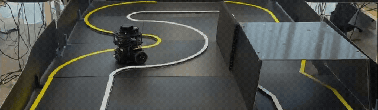
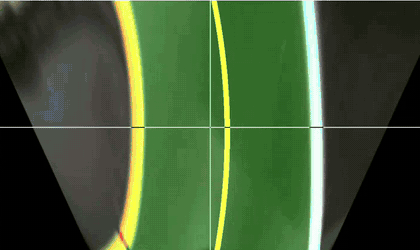

# TurtleBot3 AutoRace Lane Follower — Part 1 (classical computer vision, ROS 2 Humble)

A real TurtleBot3 Burger follows the lane between a **yellow line** and a **white line** on our arena,
using the official **ROBOTIS TurtleBot3 AutoRace** packages: camera calibration, bird's-eye
projection, HSV colour thresholds for lane detection, and lane control.

> **Part 2** replaces the hand-tuned colour thresholds with deep learning (U-Net segmentation):
> **[AkramSakly/turtlebot3-lane-follower](https://github.com/AkramSakly/turtlebot3-lane-follower)**

<p align="center">
  <br>
  <em>The robot driving the arena with the AutoRace lane follower</em>
</p>

<p align="center">
  <br>
  <em>Lane detection (<code>/detect/image_lane/compressed</code>): bird's-eye view, yellow and white lines detected, lane filled in green (6x speed)</em>
</p>

Full-length recordings: [robot on the arena (MP4)](media/robot_arena.mp4) ·
[terminals + lane detection, 2 min (MP4)](media/autorace_run_screen.mp4)

## How it works

```
Pi camera ─► compressed republisher (robot) ─► intrinsic calibration (undistort)
          ─► extrinsic calibration (bird's-eye projection) ─► detect_lane (HSV: yellow + white)
          ─► lane centre ─► control_lane (PD steering) ─► /cmd_vel
```

| Stage | Package / node | What it does |
| --- | --- | --- |
| Camera | `camera_ros` + `image_transport republish` (robot) | 320x240 images, sent to the PC as JPEG |
| Intrinsic calibration | `turtlebot3_autorace_camera` | Removes lens distortion |
| Extrinsic calibration | `turtlebot3_autorace_camera` | Projects the road to a top-down (bird's-eye) view |
| Lane detection | `turtlebot3_autorace_detect` | HSV thresholds ([ours](config/lane_hsv_calibration.yaml)) find the yellow and white lines, fit them, compute the lane centre |
| Lane control | `turtlebot3_autorace_mission` | Steers toward the lane centre, publishes `/cmd_vel` |

## Requirements

- TurtleBot3 Burger with Raspberry Pi camera, ROS 2 Humble on the robot and on the remote PC
- ROBOTIS AutoRace packages on the PC:

```bash
cd ~/turtlebot3_ws/src/
git clone -b humble https://github.com/ROBOTIS-GIT/turtlebot3_autorace.git
cd ~/turtlebot3_ws && colcon build --symlink-install && source install/setup.bash
```

One-time installs:

```bash
# On the TurtleBot
sudo apt update
sudo apt install ros-humble-camera-ros ros-humble-image-transport-plugins ros-humble-compressed-image-transport
# On the remote PC
sudo apt install ros-humble-image-transport-plugins ros-humble-compressed-image-transport ros-humble-camera-calibration
```

## Run (in this order)

### On the TurtleBot (3 SSH terminals)

**1. Robot bringup**
```bash
ros2 launch turtlebot3_bringup robot.launch.py
```

**2. Camera** — the driver's own compressed topic is empty with BGR888, so it is moved out of the way:
```bash
ros2 run camera_ros camera_node --ros-args -p format:=BGR888 -p width:=320 -p height:=240 \
  -p camera_info_url:=file:///home/$USER/.ros/camera_info/YOUR_FILE.yaml \
  -r /camera/image_raw/compressed:=/camera/unused/compressed
```
Replace `YOUR_FILE.yaml` with the name shown by `ls ~/.ros/camera_info/`.

**3. Compressed republisher** — creates proper JPEG images for the PC:
```bash
ros2 run image_transport republish raw compressed --ros-args \
  -r in:=/camera/image_raw -r out/compressed:=/camera/image_raw/compressed
```

### On the remote PC

**4. Check the images** (`format` must contain `jpeg`):
```bash
ros2 topic hz /camera/image_raw/compressed
ros2 topic echo /camera/image_raw/compressed --field format --once
```

**5. Check the calibration is loaded** (`k:` must not be all zeros):
```bash
ros2 topic echo /camera/camera_info --once
```

**6. Intrinsic calibration node**
```bash
ros2 launch turtlebot3_autorace_camera intrinsic_camera_calibration.launch.py
```

**7. Extrinsic calibration node**
```bash
ros2 launch turtlebot3_autorace_camera extrinsic_camera_calibration.launch.py
```

**8. Lane detection**
```bash
ros2 launch turtlebot3_autorace_detect detect_lane.launch.py
```

**9. Lane control — the robot starts moving**
```bash
ros2 launch turtlebot3_autorace_mission control_lane.launch.py
```

**Stop:** Ctrl+C in terminal 9, then
```bash
ros2 topic pub --once /cmd_vel geometry_msgs/msg/Twist "{}"
```

View the detection in `rqt_image_view`: `/detect/image_lane/compressed` (lane), plus the yellow and white marker images.

## Camera calibration (if no `.yaml` file yet)

Run steps 1–3 on the robot **without** `camera_info_url` in step 2, then on the PC:
```bash
ros2 run camera_calibration cameracalibrator --size 8x6 --square 0.025 \
  --ros-args -r image:=/camera/image_raw -r camera:=/camera
```
Use your board's inner-corner count and square size (metres). Move the board until the bars are green,
click **CALIBRATE**, then **COMMIT**. The file appears in `~/.ros/camera_info/` on the robot; restart step 2
with `camera_info_url` and continue from step 4.

## Our calibrated parameters

Values tuned on our arena with `rqt` (saved with `ros2 param dump`), in [`config/`](config/).

### Camera intrinsic calibration — [`config/camera_intrinsic_ost_800x600.yaml`](config/camera_intrinsic_ost_800x600.yaml)

Calibrated with `camera_calibration` at 800x600 using the **equidistant (fisheye)** lens model.

```
K = [ 284.00717   -0.50803   400.26605 ]      D (equidistant k1..k4) =
    [   0         289.34836  295.60867 ]      [ -0.308274, 1.748583, -1.910241, 0.010732 ]
    [   0           0          1       ]
```

| Property | Value |
| --- | --- |
| Focal length fx / fy | 284.0 / 289.3 px |
| Principal point cx / cy | 400.3 / 295.6 px (image centre 400 / 300) |
| Skew | -0.508 px (negligible) |
| Lens model | equidistant (fisheye), 4 coefficients |

The camera streams at 320x240, and the file loaded with `camera_info_url` must match the stream size.
[`config/camera_intrinsic_320x240_scaled.yaml`](config/camera_intrinsic_320x240_scaled.yaml) is the same
calibration with K and P scaled by 0.4 (fx 113.60287, fy 115.73934, cx 160.10642, cy 118.24347); the distortion
coefficients do not change with image size.

Note: with these coefficients the fisheye distortion curve stops increasing about 48° from the optical axis,
so the outer edges of the image are not well described by the model. This usually means the checkerboard
did not reach the image corners during calibration; recalibrating with the board moved into the corners
would improve the edges. Lane detection only uses the lower centre of the image, so it is not affected much.

### Lane colour thresholds — [`config/lane_hsv_calibration.yaml`](config/lane_hsv_calibration.yaml)

| Line | Hue (low–high) | Saturation (low–high) | Lightness (low–high) |
| --- | --- | --- | --- |
| White | 0 – 179 | 0 – 70 | 180 – 255 |
| Yellow | 10 – 127 | 70 – 255 | 95 – 255 |

- **White** = any hue, low saturation, high lightness: bright, colourless pixels.
- **Yellow** = coloured (saturation ≥ 70) and fairly bright (lightness ≥ 95). The hue range is wide, so the
  saturation and lightness limits do most of the work of separating yellow from the dark floor.

### Bird's-eye projection (extrinsic calibration) — [`config/extrinsic_projection_calibration.yaml`](config/extrinsic_projection_calibration.yaml)

| Parameter | Value (pixels) |
| --- | --- |
| `top_x` | 55 |
| `top_y` | 25 |
| `bottom_x` | 180 |
| `bottom_y` | 159 |

These four values set the trapezoid of road that `image_projection` warps into the top-down view.

### Lane controller — [`modified_robotis/control_lane.py`](modified_robotis/control_lane.py)

We used the ROBOTIS PD lane controller with **one change: Kd = 0.002 instead of 0.007**.

```
error     = lane_centre - 500                        (pixels in the projected image)
angular_z = -(Kp * error + Kd * (error - last_error)),  clipped to ±2.0 rad/s
linear_x  = min(MAX_VEL * max(1 - |error| / 500, 0) ** 2.2, 0.05)   (MAX_VEL = 0.1)
```

| Gain | ROBOTIS humble | Ours |
| --- | --- | --- |
| Kp | 0.0025 | 0.0025 |
| Kd | 0.007 | **0.002** |
| Speed cap | 0.05 m/s | 0.05 m/s |

The robot slows down automatically when the error is large (the `** 2.2` term) and never exceeds 0.05 m/s.
To use it, replace `turtlebot3_autorace_mission/turtlebot3_autorace_mission/control_lane.py` in your
`turtlebot3_autorace` clone with this file and rebuild.

### How to use them

The files are parameter dumps taken in calibration mode (`is_*_calibration_mode: true`). To use the values
for driving, copy the numbers into the ROBOTIS package files and rebuild:

- HSV values → `turtlebot3_autorace_detect/param/lane/lane.yaml`
- Projection values → `turtlebot3_autorace_camera/calibration/extrinsic_calibration/projection.yaml`

```bash
cd ~/turtlebot3_ws && colcon build --symlink-install && source install/setup.bash
```

To retune: launch steps 7 and 8 with calibration mode on, open `rqt` → Dynamic Reconfigure / Parameters,
adjust while watching `/detect/image_yellow_lane_marker/compressed` and
`/detect/image_white_lane_marker/compressed`, then save with
`ros2 param dump /detect_lane > lane_hsv_calibration.yaml`.

## Troubleshooting

| Problem | Fix |
| --- | --- |
| `image_republisher` errors about empty images | Camera's compressed output is empty with BGR888: use the remap in step 2 and the republisher in step 3 |
| `k:` all zeros in `/camera/camera_info` | Calibration file not loaded: check the `camera_info_url` path |
| Error still appears after step 6 | Run `ros2 node info /image_republisher` and check it subscribes to `/camera/image_raw/compressed` |
| Robot does not move | Make sure step 9 is running and nothing else publishes `/cmd_vel` |

## Part 1 vs Part 2

| | Part 1 (this repo) | [Part 2](https://github.com/AkramSakly/turtlebot3-lane-follower) |
| --- | --- | --- |
| Line detection | HSV colour thresholds (hand-tuned) | U-Net CNN segmentation (learned from labelled images) |
| Image | Bird's-eye view after extrinsic calibration | Raw camera image, 256x192 |
| Lighting changes | Thresholds must be retuned | Trained on lights on / off |
| Code | ROBOTIS AutoRace packages | Own ROS 2 package `tb3_lane_center` |

## Credits and license

Lane detection and control use the [ROBOTIS TurtleBot3 AutoRace](https://github.com/ROBOTIS-GIT/turtlebot3_autorace)
packages (Apache 2.0), see the [ROBOTIS e-Manual](https://emanual.robotis.com/docs/en/platform/turtlebot3/autonomous_driving/).
Documentation and media in this repository: MIT.
